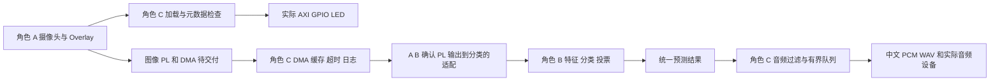

# 角色 C 工程分析与技术架构

分析日期：2026-10-09。工作对象是 `比赛项目——基于PYNQ的手语识别系统/code/sign-language-pynq`；学习路线的 DFF 练习与其他赛题资料不属于本次集成范围。

## 一 任务依据与范围

`report/execution_plan.md` 第 4 节明确 C 为音频和板端负责人，指定七个脚本及 Overlay/寄存器/DMA/Cache/超时复位/日志工作。其开头声明当前唯一有效计划，冲突时以 2026-10-01 更新版为准；根目录 `execution_plan.md` 内容相同。

旧 Word《分工及推进计划(2).docx》第 17 段把 C 定为 PS/算法负责人；旧 README、词汇表和详细制作方案也采用早期类别或 RGB/HSV 流程。更新计划与 `labels.py`、`preprocess.py`、`predictor.py` 一致：B 负责算法，C 负责音频和板端，PL 共用 YCrCb 预处理。没有沿用旧文档的样例寄存器地址或示例性能数值。

用户在本轮明确确认：**A 尚未交付，先完成可独立验证部分**。因此实际图像协议和 FPGA 端到端接入等待 A/B，C 不擅自实现 A 的 HLS 或修改 B 的模型。

| 部分 | 开发前状态 | 本轮工作 |
|---|---|---|
| 标签、中文文字、结果格式 | 已实现，由 B 维护 | 直接复用 |
| 采集/分割/HOG/预测器 | 已有代码，板端完成度无法确认 | 阅读、回归，不修改 |
| 九类中文 WAV 与播放 | 尚未实现 | 完成 |
| PC 音频钩子 | 部分实现，缺 C 模块 | 补齐兼容模块 |
| LED bit/hwh、PS/GPIO/复位 | 已有产物，真实上板无法确认 | 完成元数据检查和板端脚本 |
| 图像 IP、DMA、HLS 仿真 | 尚未实现 | 只实现通用 PS DMA 事务及软件模型测试 |
| 板卡/音箱/连续30分钟实测 | 无法确认且本机不可执行 | 提供工具、命令和日志格式 |

## 二 与其他成员的关系

C 的控制程序运行于 PS 的 Python 用户空间，不新增 FPGA RTL 时钟域。已有 PL 逻辑由 PS `M_AXI_GP0` 经 SmartConnect 到 GPIO；100 MHz 共用 `FCLK_CLK0`，复位由 proc_sys_reset 产生低有效 `peripheral_aresetn`。顶层 `system_wrapper` 只有 DDR、FIXED_IO 和 `leds_4bits_tri_io`，没有 AXI-Stream 图像外部端口。

## 三 接口定义

| 接口 | 已有定义/位宽 | 时序或协议 | 依据 |
|---|---|---|---|
| `play_wav_for_label(label)` | 标签字符串 | 同步播放；unknown 静默 | `realtime_sign_pc.py` 已有导入和调用 |
| 统一结果 | `label/text/confidence/kind/timestamp` | dict；confidence 0..1；kind static/dynamic | `labels.py` |
| 音频 PCM | 本轮选定的交付文件：1声道、16kHz、16位有符号PCM | 软件文件格式，不是 PL 音频端口 | `synthesize_windows.ps1`、WAV 检查和 manifest |
| GPIO IP | `axi_gpio_0`，32-bit AXI data，4-bit GPIO | AXI-Lite 经 SmartConnect | 两个实际 HWH 与 BD |
| GPIO 地址 | `0x41200000..0x4120FFFF` | `GPIO_DATA` 0x0；`GPIO_TRI` 0x4 | HWH 的 MEMRANGE/REGISTER |
| PL 时钟 | 100,000,000 Hz | PS `FCLK_CLK0` | HWH PORT/BD net |
| PL 复位 | `s_axi_aresetn`，低有效 | `rst_ps7_0_100M/peripheral_aresetn` | HWH PORT/BD net |
| DMA PS 通道 API | `sendchannel/recvchannel.transfer()`、`wait()` | 物理连续缓冲，通道状态轮询 | PYNQ 2.7 官方驱动 |
| 图像输入和输出 | **尚缺**：真实像素位宽、shape、打包与字节序 | AXI-Stream 的 TLAST/TKEEP 尚缺 | 两个 BD/HWH 均无 DMA/HLS |
| HLS 控制 | **尚缺**：IP 名、register_map、地址、启动复位方式 | 待 A 交付，不预设 AP_CTRL 或帧尺寸寄存器 | 同上 |

新的 `AudioAnnouncer` 和 `DmaTransfer` 是 C 的软件 API，具体说明在 `audio/README.md`、`board/README_role_c.md`；不是把尚缺的硬件接口命名为既成事实。

## 四 状态机 数据流和约束

音频：结果校验 → unknown/低置信度过滤 → monotonic 冷却和同标签防重复 → 验证 WAV → 有界队列 → 后台播放 → 成功/失败事件。队列满时立即返回，不更新接受时间。沿用 B 配置的置信度0.5、冷却1.5s、防重复3s；调用方可按同一个配置覆盖。

DMA：`READY -> ACTIVE -> READY`；ACTIVE 异常则 `FAULTED`，复位确认后可释放进入 `CLOSED`。未确认复位时隔离缓冲，禁止释放；故障不能直接回 READY，因为上游 HLS 状态可能已经不同步。接收先启动，解决输出反压可能阻塞发送的问题。输入 flush 保证 PL 看到 CPU 写入；接收 flush 清理旧脏行，完成后 invalidate 保证 CPU 看到 PL 输出。

CPU 线程不是 FPGA 时钟，不能用其墙上时间声称 PL 流水线延迟。当前没有 DMA 时钟域或 PL 延迟数据。单帧物理缓冲占用约输入字节数加输出字节数，复用缓冲以免每帧分配 CMA；队列最大两条待播放加一条正在播放。真正吞吐率、II、LUT/FF/BRAM/DSP 和时序由 A 的 HLS/综合报告与板卡测试确定。

音频为约1.1～1.5秒的完整词语。推理线程可不阻塞，但“播报开始时间”和“整段语音播放完成时间”必须分开测量，不能声称整段播报完成满足300ms。

## 五 风格与文件范围

现有主要 Python 模块使用四空格、snake_case 文件/函数/信号、大写常量、大驼峰类名、中文 docstring、argparse CLI 和 pytest。C 延续此风格，采用 `python -m audio...`/`python -m board...` 的包入口，不改动根目录 B 的导入结构。没有为了风格改写学习目录 RTL 或 Vivado 生成 Wrapper。

| 新增文件范围 | 功能及原因 | 其他成员代码 |
|---|---|---|
| `audio/*.py`、`audio/synthesize_windows.ps1`、`audio/wav/*` | 计划要求的中文映射、真实WAV、播放与测试工具 | 只读 labels/config |
| `board/load_overlay.py`、`overlay_register_test.py`、`audio_board_test.py` | 计划指定的加载与联调入口 | 只读既有 bit/hwh |
| `board/dma_transfer.py`、`dma_board_test.py` | 缓存、有限超时、复位和连续黄金比对 | 待实际 A 接口，不修改硬件 |
| `board/run_log.py`、`verify_role_c.py`、`role_c_benchmark.py` | 日志、复现和 C 的 CPU 参考计时 | 只调用既有 B 算法 |
| `tests/test_role_c_*.py` | 正常、边界、无效、连续、背压、错误恢复模型 | 不修改 B 的断言 |
| C 的 README、`requirements_role_c.txt`、`report/role_c_*` | 集成、环境、分析、修复和学习交付 | 不修改公共文档 |

## 六 关键设计依据

项目证据：`report/execution_plan.md`、`labels.py`、`predictor.py`、`realtime_sign_pc.py`、实际两个 `.bd` 与 `.hwh`。BD 连接快照保存到 `role_c_logs/bd_connections.json`，源码阅读清单保存到 `role_c_source_inventory.md`。

外部主源仅用于既有 PYNQ/标准 DMA API 的核查：

- [PYNQ 2.7 DMA 官方驱动](https://pynq.readthedocs.io/en/v2.7.0/_modules/pynq/lib/dma.html)：核查 wait 没有 timeout 参数、通道状态和实际字节统计。
- [PYNQ allocate 官方说明](https://pynq.readthedocs.io/en/v2.7.0/pynq_libraries/allocate.html)：核查物理连续内存和 flush/invalidate。
- [PYNQ Overlay 官方说明](https://pynq.readthedocs.io/en/v2.7.0/pynq_libraries/overlay.html)：核查 bit/hwh 加载与 ip_dict。
- [AMD PG021 MM2S 控制寄存器](https://docs.amd.com/r/en-US/pg021_axi_dma/MM2S_DMACR-MM2S-DMA-Control-Register-Offset-00h)：软复位位与全核复位规则。
- [AMD PG021 S2MM 状态寄存器](https://docs.amd.com/r/en-US/pg021_axi_dma/S2MM_DMASR-S2MM-DMA-Status-Register-Offset-34h)：标准状态位。
